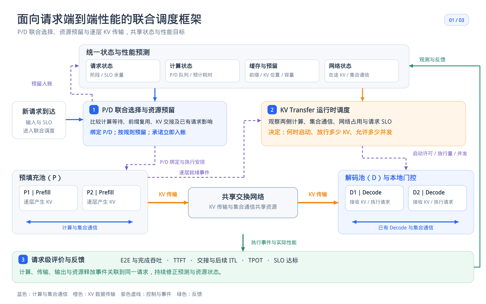
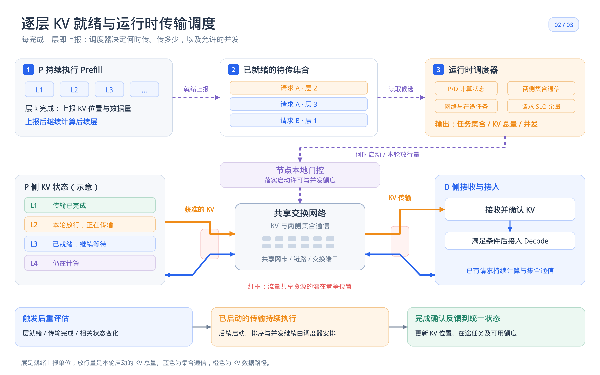
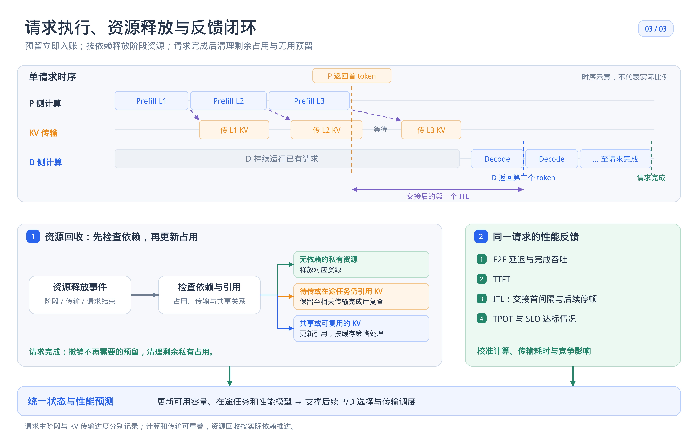

# 面向请求端到端性能的联合调度框架说明

## 一 框架简介

这套框架以完整请求的 SLO 达标情况与完成吞吐为目标，P 表示 Prefill 实例，D 表示 Decode 实例，两类决策共享状态、性能预测与请求级目标

### 图 1 整体联合调度架构

统一维护请求、计算、缓存和网络状态

新请求到达后，调度器综合排队、前缀复用、容量、KV 交接的影响，联合选择 P/D，并立即将资源预留计入账本

### 图 2 逐层 KV 就绪与运行时传输调度

P 每完成一层就上报该层 KV 的位置与数据量，随后继续计算

调度器从已就绪 KV 块中决定启动哪些块、放行多少数据以及允许的并发

本地门控落实许可，已经启动的传输持续执行

### 图 3 请求执行与资源反馈闭环

P 完成 Prefill 后返回首 token

D 在所需 KV、交接信息和资源就绪后进入现有本地调度，继续输出后续 token

特别地，Prefill 完成后仍有待传或在途读取依赖的源端 KV 需要继续保留

请求完成后撤销无用预留、清理可释放占用，共享前缀按引用关系和缓存策略处理

## 二 P/D 对选择

P/D 对选择是在新请求到达后，联合确定负责 Prefill 的 P 实例和负责后续 Decode 的 D 实例，选择以完整请求的 SLO 达标情况与完成吞吐为目标，并考虑新请求加入后对已有请求的影响

### 1 决策变量

$$
x_{ipd}\in\{0,1\}
$$

$x_{ipd}=1$ 表示将请求 $i$ 绑定到 P/D 对 $(p,d)$，否则为 0

以下优化针对当前待绑定请求 $i$，候选对需满足下述容量与执行条件约束

### 2 优化目标

根据前缀复用、P/D 计算负载和 KV 可用时刻，为每个候选对预测：

- $\widehat F_{ipd}$：首 token 延迟，即 TTFT
- $\widehat H_{ipd}$：首 token 到第二个 token 的交接间隔，也是一次 ITL，单独预测以体现 P 到 D 的交接影响
- $\widehat I_{ipd}$：第二个 token 之后的最大相邻 token 间隔，即后续最大 ITL

其中，D 必须等待 P 完成、所需 KV、交接信息和资源就绪，并经过本地调度后执行，这些影响计入上述预测

令 $\tau_i^F$ 和 $\tau_i^I$ 分别表示 TTFT 与 ITL 的 SLO 阈值，均为正数

交接间隔 $\widehat H_{ipd}$ 与后续最大 ITL $\widehat I_{ipd}$ 分别预测，但统一使用 ITL 阈值 $\tau_i^I$

定义候选对的最小归一化 SLO 余量：

$$
\boxed{
m_{ipd}=\min\left\{
\frac{\tau_i^F-\widehat F_{ipd}}{\tau_i^F},
\frac{\tau_i^I-\widehat H_{ipd}}{\tau_i^I},
\frac{\tau_i^I-\widehat I_{ipd}}{\tau_i^I}
\right\}
}
$$

归一化使不同阈值下的余量可以比较，$m_{ipd}\ge0$ 表示该候选对的所有适用指标均预测达标，$m_{ipd}<0$ 表示至少一项预测超限

对当前请求的优化目标为：

$$
\boxed{
\max_{\boldsymbol x_i}
\quad\sum_{p,d}m_{ipd}x_{ipd}
}
$$

即：在可行候选对中，选择最紧张的 SLO 项仍有较大余量的 P/D 对，该目标是请求级的选择准则，用于服务框架整体的 SLO 达标与完成吞吐目标

### 3 约束

本轮执行绑定时，选择且只选择一个实例对：

$$
\sum_{p,d}x_{ipd}=1.
$$

各内存域的实际占用、已有预留和新增预留不超过容量：

$$
O_n+R_n+\sum_{p,d}\rho_{in}^{pd}x_{ipd}\le M_n,
\qquad\forall n.
$$

- $n$：物理内存域，例如 GPU 显存或接收缓存
- $O_n$：内存域 $n$ 的实际占用，共享物理对象只计一次
- $R_n$：内存域 $n$ 已承诺但尚未转为实际占用的预留总量
- $\rho_{in}^{pd}$：将请求 $i$ 绑定到 $(p,d)$ 后，在内存域 $n$ 上需要新增的预留
- $M_n$：内存域 $n$ 可供调度使用的总容量，已扣除固定占用

P 侧新增预留覆盖前缀复用后的增量 KV 与必要缓冲，D 侧覆盖尚缺输入 KV、请求允许的最大输出增长及必要缓冲。绑定确定后立即登记新增预留；预留转为实际占用时等量转换，避免重复计数

只能选择具备执行条件的候选对：

$$
x_{ipd}\le A_{ipd},
\qquad x_{ipd}\in\{0,1\}.
$$

其中，$A_{ipd}\in\{0,1\}$，$A_{ipd}=1$ 表示实例对可用且具备执行条件

## 三 KV 调度机制

KV 调度在既定 P/D 绑定下，决定已就绪 KV 块的启动时机、放行数据量与并发。调度器结合两侧集合通信需求和共享网络状态分配启动预算，综合请求交接的紧迫程度安排传输，以控制 KV 传输对集合通信的干扰，并提高请求级 SLO 达标完成吞吐

具体流程是：

1. **逐层就绪、分块待传**：P 完成一层后，上报 KV 的位置和大小，随后继续计算，已就绪数据按有大小上限的块组织
2. **确定可用预算**：根据 P/D 两侧集合通信需求、背景流量和网络容量，扣除保护预算及安全余量，确定本轮可以放行多少 KV
3. **按 SLO 余量排序**：结合请求的 KV 最晚交付时间和预计剩余完成时间，优先处理仍可达标、余量较小的请求
4. **门控启动**：在并发和在途字节额度内启动块，已有在途传输也计入额度，启动后持续执行，实际速率由底层网络共享机制决定
5. **事件反馈**：层就绪、传输完成、集合通信或资源状态变化时，更新预算、优先级和预测，源端 KV 在读写等依赖解除后才允许释放
