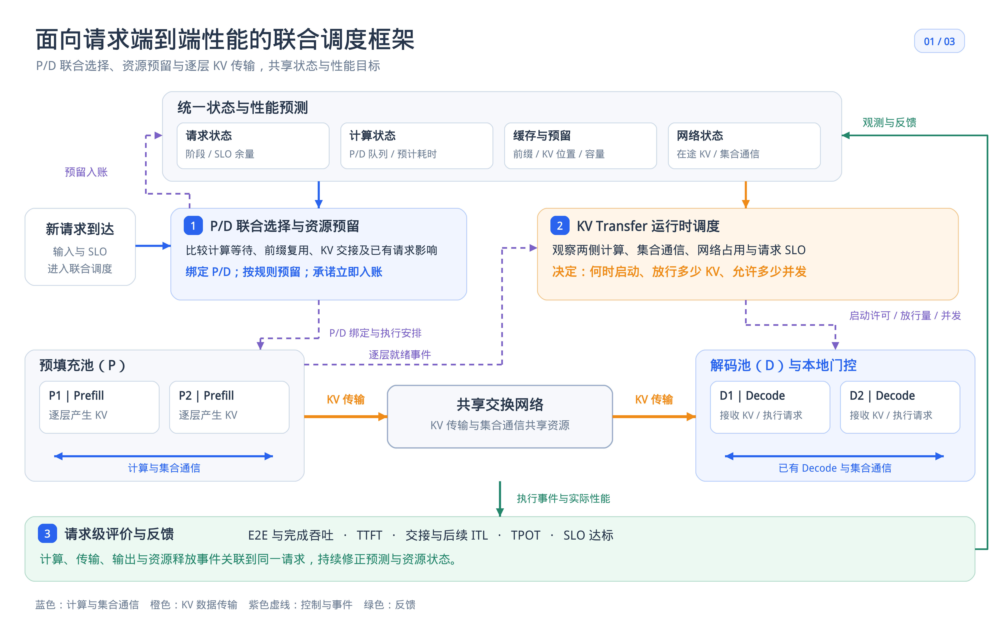
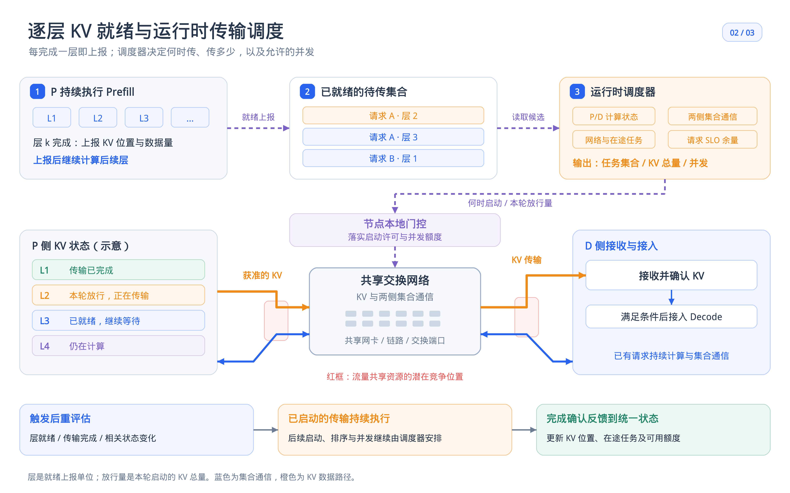
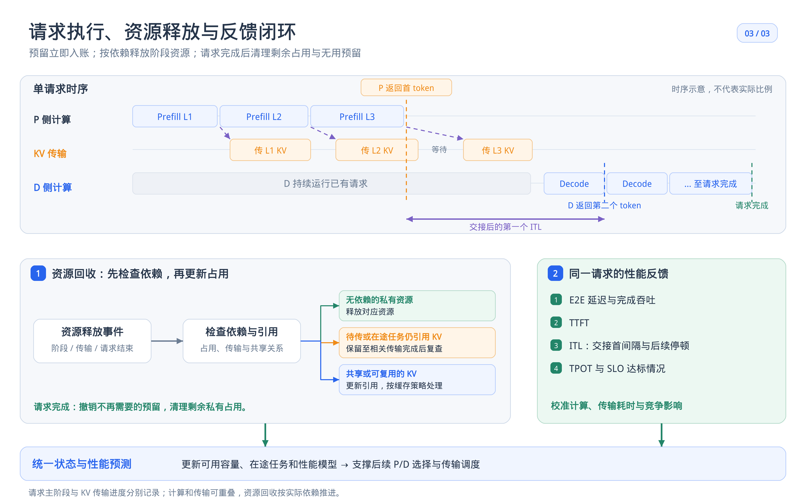

# 面向请求端到端性能的联合调度框架说明

实现状态：已完成逐层 KV、动态网络观测、共享资源令牌额度、集合通信保护与请求级 SLO 余量优先级；具体启发式算法见 joint_scheduling/kv_scheduler/README.md。联合绑定已实现候选剪枝与增量贪心，下文的优化式描述研究目标，不代表求得全局最优；执行方法和模型边界见 joint_scheduling/backend/README.md。

绑定窗口、前缀缓存感知预测及延迟可见状态已实现，可与 Chunked/合批 Prefill、Decode 连续批处理组合。联合模式在绑定时整批原子预留，轮询模式在 Prefill 准入时预留；有限范围预测及聚合网络近似的边界见 joint_scheduling/binding/README.md。

## 一 框架简介

这套框架以完整请求的 SLO 达标情况与完成吞吐为目标，P 表示 Prefill 实例，D 表示 Decode 实例，两类决策共享状态、性能预测与请求级目标

### 图 1 整体联合调度架构

统一维护请求、计算、缓存和网络状态，并记录 P/D 所在节点、机架及它们之间的网络路径

新请求到达后先进入待调度队列，调度器在短时间窗口内收集请求；窗口触发时，综合排队、前缀复用、容量、实例位置与 KV 交接的影响，为多个待绑定请求联合选择 P/D，并立即将资源预留计入账本

图中的新请求先进入待调度队列，P/D 选择由窗口触发；共享交换网络对应实际传输路径上的共享链路与端口资源

### 图 2 逐层 KV 就绪与运行时传输调度

P 每完成一层就上报该层 KV 的位置与数据量，随后继续计算

调度器从已就绪 KV 块中决定启动哪些块、放行多少数据以及允许的并发

本地门控落实许可，已经启动的传输持续执行

### 图 3 请求执行与资源反馈闭环

P 完成 Prefill 后返回首 token

D 在所需 KV、交接信息和资源就绪后进入现有本地调度，继续输出后续 token

特别地，Prefill 完成后仍有待传或在途读取依赖的源端 KV 需要继续保留

请求完成后撤销无用预留、清理可释放占用，共享前缀按引用关系和缓存策略处理

## 二 P/D 对选择

P/D 对选择是在调度窗口触发后，为多个待绑定请求联合确定负责 Prefill 的 P 实例和负责后续 Decode 的 D 实例，选择以完整请求的 SLO 达标情况与完成吞吐为目标，并考虑本轮新增请求之间的竞争及它们对已有请求的影响

设调度时刻为 $t_k$，常规调度间隔为 $\Delta$，本轮待绑定请求集合为 $\mathcal Q_k$，包括上个间隔内新到达的请求和此前暂缓的请求。每轮根据当前已知请求与资源状态决策，未绑定请求保留到后续轮次；已有请求的 P/D 绑定保持不变。临近 TTFT 截止时间时可提前触发调度，窗口长度、提前触发条件与最大等待时间需结合工作负载和 SLO 确定

本说明将实例部署位置视为已知输入，记录同节点、同机架和跨机架关系，以及传输路径的时延、有效带宽和拥塞。若实例跨多个 GPU 或节点，则按 KV 块实际发送与接收位置对应的路径核算。位置通过通信代价影响 P/D 选择；本轮不改变实例的部署位置

### 1 决策变量

$$
x_{ipd}\in\{0,1\}
$$

$x_{ipd}=1$ 表示本轮将请求 $i\in\mathcal Q_k$ 绑定到 P/D 对 $(p,d)$，否则为 0；为保持记号简洁，省略变量的轮次上标

增加本轮绑定变量和预测达标变量：

$$
y_i,z_i\in\{0,1\},\qquad i\in\mathcal Q_k.
$$

$y_i=1$ 表示请求 $i$ 在本轮绑定，$y_i=0$ 表示本轮暂缓；$z_i=1$ 表示请求在本轮绑定且所选方案的所有适用指标均预测达标。$z_i=0$ 不等同于拒绝请求

以下优化针对本轮全部待绑定请求，记整体绑定方案为 $\boldsymbol X=\{x_{ipd}\}$，候选对需满足下述容量、执行条件与达标计数约束

### 2 优化目标

根据前缀复用、P/D 计算负载、实例位置、传输路径和 KV 可用时刻，为每个候选对预测：

- $\widehat F_{ipd}$：首 token 延迟，即 TTFT
- $\widehat H_{ipd}$：首 token 到第二个 token 的交接间隔，也是一次 ITL，单独预测以体现 P 到 D 的交接影响
- $\widehat I_{ipd}$：第二个 token 之后的最大相邻 token 间隔，即后续最大 ITL

其中，D 必须等待 P 完成、所需 KV、交接信息和资源就绪，并经过本地调度后执行，这些影响计入上述预测

上述预测随本轮整体绑定方案 $\boldsymbol X$ 变化，需计入同轮请求之间及其与已有请求之间的计算排队、内存和共享链路竞争，不能将各请求在孤立状态下的预测作为固定分数直接相加。这里保持原下标，省略对 $\boldsymbol X$ 的函数依赖

设请求到达时刻为 $a_i$，TTFT 从到达时刻开始计算，即 $\widehat F_{ipd}=(t_k-a_i)+\widehat T_{ipd}^{\mathrm{remain}}$，其中 $\widehat T_{ipd}^{\mathrm{remain}}$ 为从 $t_k$ 到首 token 返回的预计剩余时间，包含本轮调度与派发开销、后续排队及计算；已发生的窗口等待必须计入 TTFT

KV 交接预测根据实际路径的时延、有效带宽、拥塞和待传数据量，结合逐层就绪及计算与传输重叠，估计所需 KV 在 D 侧全部就绪的时刻。由于首 token 由 P 返回，交接等待直接计入 $\widehat H_{ipd}$；KV 传输对集合通信的竞争还可能间接影响 $\widehat F_{ipd}$ 和 $\widehat I_{ipd}$，不将完整 KV 传输时间重复累加到 TTFT

令 $\tau_i^F$ 和 $\tau_i^I$ 分别表示 TTFT 与 ITL 的 SLO 阈值，均为正数

交接间隔 $\widehat H_{ipd}$ 与后续最大 ITL $\widehat I_{ipd}$ 分别预测，但统一使用 ITL 阈值 $\tau_i^I$

定义候选对的最小归一化 SLO 余量：

$$
\boxed{
m_{ipd}=\min\left\{
\frac{\tau_i^F-\widehat F_{ipd}}{\tau_i^F},
\frac{\tau_i^I-\widehat H_{ipd}}{\tau_i^I},
\frac{\tau_i^I-\widehat I_{ipd}}{\tau_i^I}
\right\}
}
$$

归一化使不同阈值下的余量可以比较，$m_{ipd}\ge0$ 表示该候选对的所有适用指标均预测达标，$m_{ipd}<0$ 表示至少一项预测超限

本轮优先最大化预测达标的绑定请求数，再最大化已绑定请求的 SLO 余量总和：

$$
\boxed{
\max_{\boldsymbol X,\boldsymbol y,\boldsymbol z}^{\mathrm{lex}}
\quad\left(
\sum_{i\in\mathcal Q_k}z_i,
\sum_{i\in\mathcal Q_k}\sum_{p,d}m_{ipd}x_{ipd}
\right)
}
$$

其中，$\mathrm{lex}$ 表示按顺序优化：先获得最大的预测达标请求数，再在该数量不降低的方案中改善余量。原有最小归一化 SLO 余量仍用于比较 P/D 方案，但不以单纯增大余量总和替代达标请求数目标

该目标是本轮预测达标绑定数及其余量的选择准则，用于服务框架整体的 SLO 达标与完成吞吐目标，不等同于本窗口内实际完成的请求数。已有请求的占用、预留与在途传输作为已承诺状态纳入预测和预算，并检查新增负载对其尚未发生的交接及后续 ITL 的影响，避免仅通过牺牲已有请求提高本轮指标

### 3 约束

本轮执行绑定时，每个被选中的请求选择且只选择一个实例对，暂缓请求不选择实例对：

$$
\sum_{p,d}x_{ipd}=y_i,
\qquad\forall i\in\mathcal Q_k.
$$

预测达标计数只能对应本轮已绑定且所选候选对预测达标的请求：

$$
z_i\le y_i,\qquad
z_i=1\ \land\ x_{ipd}=1\ \Longrightarrow\ m_{ipd}\ge0.
$$

由于主目标最大化 $\sum_i z_i$，预测达标的已绑定请求会计入达标数；未绑定请求不计入。仅当本轮只有一个请求且要求立即绑定时，绑定约束退化为原来的 $\sum_{p,d}x_{ipd}=1$

各内存域的实际占用、已有预留和新增预留不超过容量：

$$
O_n+R_n+\Delta R_n(\boldsymbol X)\le M_n,
\qquad\forall n.
$$

- $n$：物理内存域，例如 GPU 显存或接收缓存
- $O_n$：内存域 $n$ 的实际占用，共享物理对象只计一次
- $R_n$：内存域 $n$ 已承诺但尚未转为实际占用的预留总量
- $\Delta R_n(\boldsymbol X)$：本轮整体绑定方案在内存域 $n$ 上需要新增的预留，共享物理对象只计一次
- $\rho_{in}^{pd}$：将请求 $i$ 绑定到 $(p,d)$ 后，在内存域 $n$ 上需要新增的预留
- $M_n$：内存域 $n$ 可供调度使用的总容量，已扣除固定占用

当本轮请求之间没有需要合并计数的共享对象时，$\Delta R_n(\boldsymbol X)=\sum_{i\in\mathcal Q_k}\sum_{p,d}\rho_{in}^{pd}x_{ipd}$；存在共享前缀等对象时，按物理对象及引用关系统一核算新增预留

P 侧新增预留覆盖前缀复用后的增量 KV 与必要缓冲，D 侧覆盖尚缺输入 KV、请求允许的最大输出增长及必要缓冲。本轮绑定方案确定后立即统一登记新增预留；预留转为实际占用时等量转换，避免重复计数

只能选择具备执行条件的候选对：

$$
x_{ipd}\le A_{ipd},
\qquad x_{ipd}\in\{0,1\}.
$$

其中，$A_{ipd}\in\{0,1\}$，$A_{ipd}=1$ 表示实例对可用、网络可达且满足部署范围等执行条件。若部署策略禁止某类跨域交接，则对应 $A_{ipd}=0$；其余候选对的远近通过实际通信代价进入性能预测，不另外重复加入距离惩罚

## 三 KV 调度机制

KV 调度在既定 P/D 绑定下，决定已就绪 KV 块的启动时机、放行数据量与并发。调度器结合两侧集合通信需求和实际传输路径上的共享网络状态分配启动预算，综合请求交接的紧迫程度安排传输，以控制 KV 传输对集合通信的干扰，并提高请求级 SLO 达标完成吞吐

P/D 绑定按短时间窗口联合决策，KV 调度继续由运行时事件驱动，无需等待下一个 P/D 调度窗口；同一窗口内绑定的请求可派发到不同实例，并不要求组成同一个计算批次

具体流程是：

1. **逐层就绪、分块待传**：P 完成一层后，上报 KV 的位置和大小，随后继续计算，已就绪数据按有大小上限的块组织
2. **确定可用预算**：根据 P/D 两侧集合通信需求、背景流量和路径上的链路、端口容量，扣除保护预算及安全余量，确定本轮可以放行多少 KV；共享同一瓶颈资源的传输共同核算预算，避免仅按全网总带宽放行
3. **按 SLO 余量排序**：结合请求的 KV 最晚交付时间和预计剩余完成时间，优先处理仍可达标、余量较小的请求
4. **门控启动**：在并发和在途字节额度内启动块，检查路径上各受控共享资源的额度，已有在途传输也计入相应额度，启动后持续执行，实际速率由底层网络共享机制决定
5. **事件反馈**：层就绪、传输完成、集合通信或资源状态变化时，更新预算、优先级和预测，源端 KV 在读写等依赖解除后才允许释放
