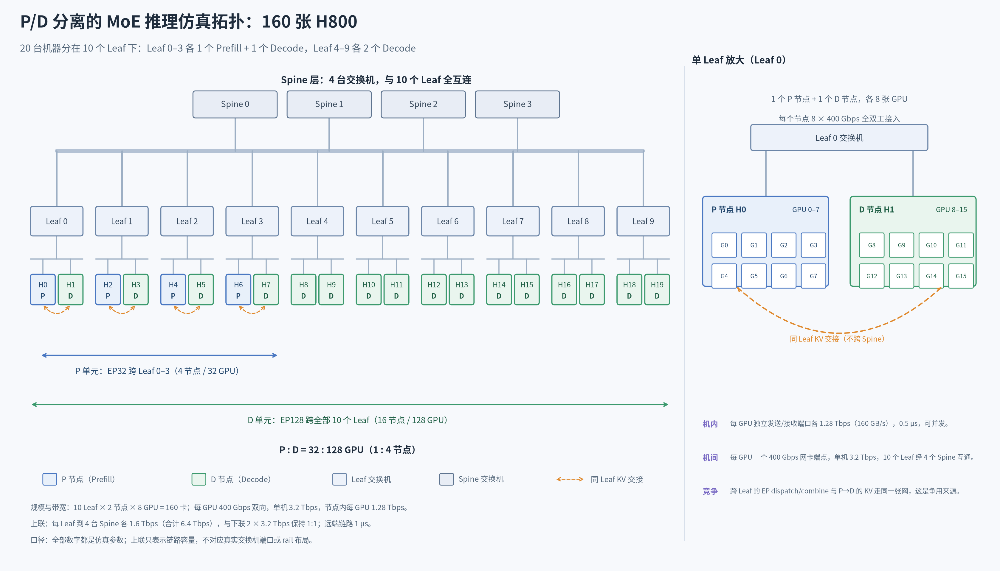

# P/D 分离 MoE 推理中的 EP/KV 竞争与 SLO 调度实验报告

**第一部分：研究条件。** 本文只做离散事件仿真：请求、计算代价、节点与网络全部由本仓库执行器在 CPU 上推进，H800 只是计算代价的标签；下文所有结论都只在这一仿真口径内成立。

## 1. 研究问题

P/D 分离的 MoE 推理中，跨节点 EP 的 dispatch/combine 与 P→D 的 KV 交接共用同一张网络。本文只回答三个问题：两者是否存在网络争用、争用发生在哪一跳、KV 放行策略能否提高请求级 SLO 的达标完成吞吐。

## 2. 实验环境

图 1 给出整体布局；下面按“拓扑 → 带宽 → 模型 → 并行 → 负载与 SLO → 受控假设”的顺序，把后续结果的解释口径固定下来。



*左：整体拓扑；右：单 Leaf 放大。橙色虚线只示意同 Leaf 的 KV 路径（约 6%），其余约 93.75% 的 KV 跨 Leaf、经 Spine。*

### 2.1 拓扑与部署

- 全集群 160 张卡，分布在 20 台机器上，每台 8 张。
- 20 台机器分属 10 个 Leaf，每个 Leaf 挂 2 台；4 台 Spine 与 10 个 Leaf 全互连，跨 Leaf 的路径经过源 Leaf、Spine 和目标 Leaf。
- Leaf 0–3 各放 1 个 P 节点和 1 个 D 节点，Leaf 4–9 各放 2 个 D 节点：P 侧 4 节点（32 卡），D 侧 16 节点（128 卡），P:D = 1:4。
- 两侧各是一份完整模型的副本，只是按专家并行切分到多张卡上；请求到达时绑定一对 P/D，整次请求不迁移。
- P 侧根据所选模式，在对应层就绪或全部 Prefill 完成后把 KV 交给 D：同 Leaf 只经本 Leaf 交换机，跨 Leaf 才经 Spine。
- 每个 P 所在 Leaf 只有 8 个 D 实例（共 128 个），同 Leaf 概率 6.25%，因此约 93.75% 的请求跨 Leaf。

### 2.2 带宽

- 每张 GPU 一块独立网卡，400 Gbps（双向全双工）；8 张合起来是一台机器 3.2 Tbps。
- 每个 Leaf 下联 2 台机器共 6.4 Tbps，上联 4 条链路各 1.6 Tbps（分别到 4 台 Spine），上下 1:1、不超售。
- 机器内部，每张 GPU 有独立的发送和接收端口，各 1.28 Tbps（160 GB/s），延迟 0.5 μs。
- 跨机器链路延迟按 1 μs 计，路由用 ECMP，拥塞控制用 DCQCN，并配 PFC 防丢包。
- 关键点：EP 的 dispatch/combine 与 KV 交接共用这些链路，这正是本文要研究的争用来源。
- 带宽参考 [DeepEP 公布的 H800 配置](https://github.com/deepseek-ai/DeepEP/blob/v1.2.1/README.md#performance)，节点内按每 GPU 的收发端口计带宽和延迟。

### 2.3 运行的模型

- 模型固定为 DeepSeek-V3 671B：61 层，前 3 层是 Dense，后 58 层是 MoE。
- hidden size 7168；每个 MoE 层 256 个 routed 专家、按 top-8 激活，另有 1 个 shared 专家。
- Attention 用 MLA：128 个头，KV latent 512，RoPE key 64。
- 每张 GPU 80 GiB 显存并预留 5%；P 每卡放 36.6 GiB 权重，D 每卡放 22.3 GiB。
- KV 每 token 70272 B（约 68.6 KiB），TP1 下每卡只存一份。
- 计算时间取自官方 H800 CUDA trace 推导的估算 profile，只含计算，通信全部交给网络仿真。

### 2.4 采用的并行

- 张量并行 TP1：单个权重矩阵不跨卡切分；专家由 EP 分散到不同卡上。
- P 侧 Attention 走 DP32（32 个实例各接一批请求），专家走 EP32（32 张卡分装全部专家）。
- D 侧 Attention 走 DP128，专家走 EP128（128 张卡分装全部专家）。
- DP 与 EP 是同一批卡上的两种分工，不是相乘关系：DP 决定请求怎么排队，EP 决定专家放在哪张卡。
- P 的 EP32 跨 4 个 Leaf，D 的 EP128 跨全部 10 个 Leaf，专家流量因此天然跨 Leaf。
- 没有流水线并行 PP，也没有 TP 集合通信；跨卡通信只剩 EP 的 dispatch/combine 和 KV。
- 每个阶段内的 routed 专家各放一份，P 每卡 8 个、D 每卡 2 个。

### 2.5 负载与 SLO

- 负载是 Azure Public Dataset 的 conv 轨迹：19366 个真实请求，到达时间与输入/输出长度均取原值。
- 注入总时长 3501.721937 秒，全段平均 5.530421989 请求/秒；不压缩时间轴，也不重采样。
- 输入平均 1155 token（P95 4083），输出平均 211 token（P99 601）。
- SLO 取 TTFT ≤ 1 秒、相邻 token 间隔 ITL ≤ 100 ms；这是实验假设，源数据没有提供 SLO。
- 统计窗口为 `[60, 3501.721937001)` 秒，注入结束后再跑 600 秒排空；TTFT 与全部 ITL 都达标才计入 goodput。

### 2.6 受控假设

- H800 只是计算代价标签，所有事件在 CPU 上仿真，没有真机。
- 每 Leaf 到 4 台 Spine 的 1.6 Tbps 上联只表示链路容量，不对应真实交换机端口数或多 rail 布局。
- 节点内只按每 GPU 的独立收发端口计带宽和延迟，未复刻 NVSwitch 仲裁、显存访问和 DeepEP 内核。
- P:D = 1:4 是受控起点，尚未在该负载上做最优配比搜索。
- 双 micro-batch 重叠和 DeepEP 的聚合转发尚未实现。
- 短程验证与固定流量重放只用于连通性和归因，不能当作 160 卡的容量结论。

## 3. 计算与显存口径

在上一节的模型与并行下，计算、显存和 KV 的记账口径如下。

计算由官方 H800 CUDA trace 推导的仿真 profile 驱动（TP1、P-EP32 / D-EP128，标 `synthetic`）：Prefill 按 ≤512-token chunk、Decode 按 step 推进，专家计算按实际 assignments 估算；通信不计入计算时间，交给 ns-3 单独执行。

每 GPU 80 GiB，保留 5%（4 GiB）余量。P 每 GPU 权重 39308906160 B（36.6093 GiB），动态账本约 39.3907 GiB；D 权重 23979177648 B（22.3323 GiB），动态账本约 53.6677 GiB。P/D 分别使用对应的权重占用，不能继续共用一个容量值。

MLA KV 为 70272 B/token，TP1 下每卡只保留一份；长度为 L 的请求初始交接量为 `L × 70272 B`，Decode 的增量在 D 上就地物化。

## 4. 对照、判据与实验矩阵

固定环境之后，主对照只改变 KV 的放行方式：Immediate（就绪即发）、FIFO（受额度约束的 FIFO）、MLU（SLO 分级 + 集合通信保护）；原生网络优先级另做消融，不混入主对照。

主实验采用 `binding.policy=balanced_random`、独立 `binding.seed=7`：P 按到达顺序轮询，D 每 128 个请求重新打乱一轮、每个实例各用一次；请求到达时提交绑定，整次请求不迁移。绑定不参考长度、完成顺序或网络状态。三种 KV 策略及各网络 seed 共享冻结的 `inputs/binding_plan.json`，每次运行另存相同绑定表及其 SHA-256。

该绑定下跨 Leaf 请求比例的期望为 **93.75%**；Azure 全量在 seed 7 下为 **18154/19366 = 93.7416%**（仅绑定计划统计，尚非仿真结果）。旧 `round_robin` 策略保留，其局部性取决于实例布局与两池大小，不保证同 Leaf。

网格为 3 策略 × seed 7/19 = 6 次端到端，加优先级关/开 × 2 seed = 4 次；判据与统计窗口见 2.5 节。具体开关、额度、包大小等以 [base.json](joint_scheduling/configs/research/base.json) 与每次运行生成的 `comparison_audit.json` 为准。

## 5. 复现

来源基线提交为 `2fa4277`，实际运行版本以冻结源码和后端身份为准，统一入口为[研究配置](joint_scheduling/configs/research/README.md)。在仓库根目录先做预检：

```bash
./inference run-experiments --spec joint_scheduling/configs/research/kv_policy.json --output joint_scheduling/artifacts/research/kv-policy --dry-run
./inference run-experiments --spec joint_scheduling/configs/research/network_priority.json --output joint_scheduling/artifacts/research/network-priority --dry-run
```

去掉 `--dry-run` 即执行全量；运行会冻结配置、请求、profile 与后端身份，并生成 `report.md` 与 `comparison_audit.json`。图 1 由 [scripts/plot_research_topology.py](scripts/plot_research_topology.py) 从 `base.json` 的拓扑字段生成。

## 6. 边界

H800 只是计算代价标签；P:D = 1:4、端口/链路抽象与估算 profile 都是受控假设。双 micro-batch 重叠及 DeepEP 聚合转发仍未实现，短程验证与固定流量重放不能当作 160 GPU 的容量结论。此前 128 GPU / TP4 / EP8 以及共享 NIC/FIFO 场景的结果保留原口径，不与当前配置混合统计。

第二部分将在此口径下填写负载扫描、竞争证据、端到端策略结果与敏感性分析，并保留失败与未知样本。
